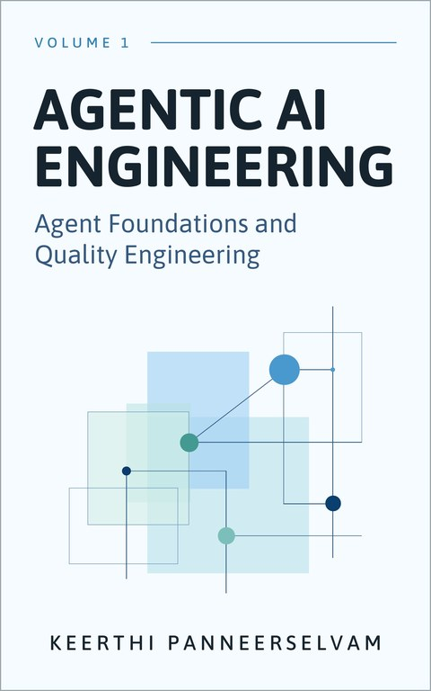
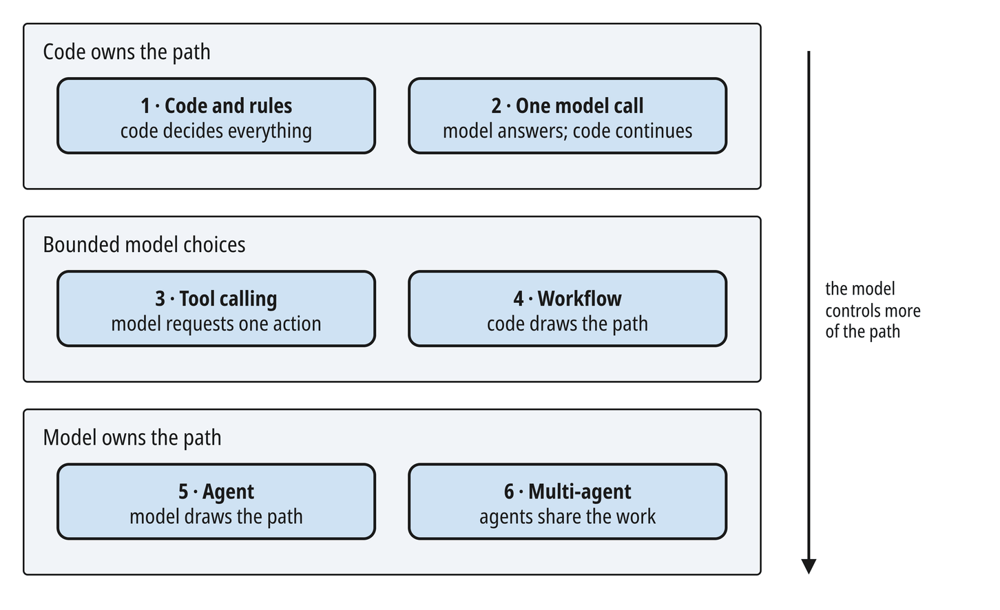
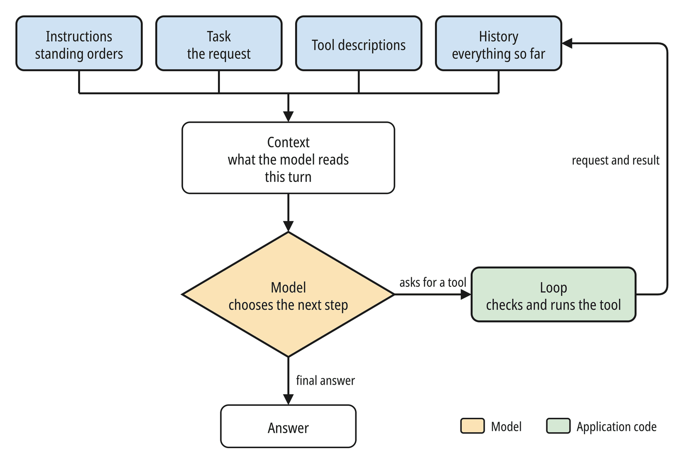
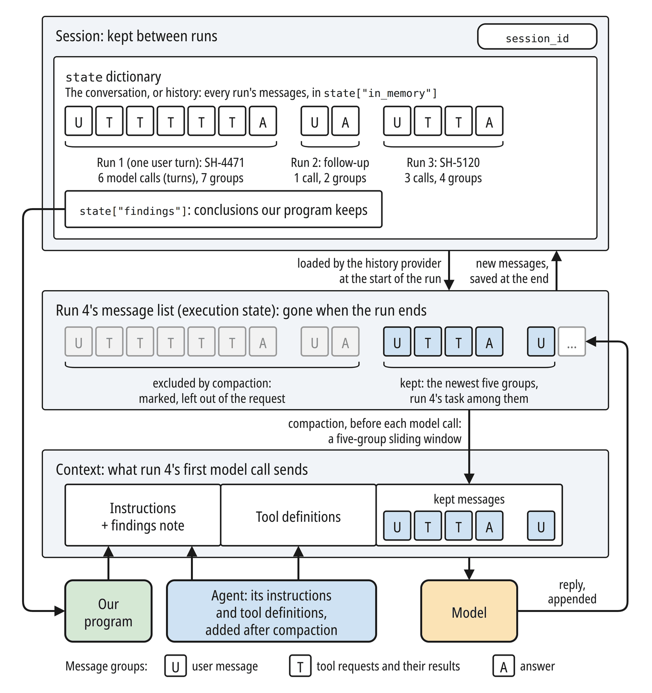
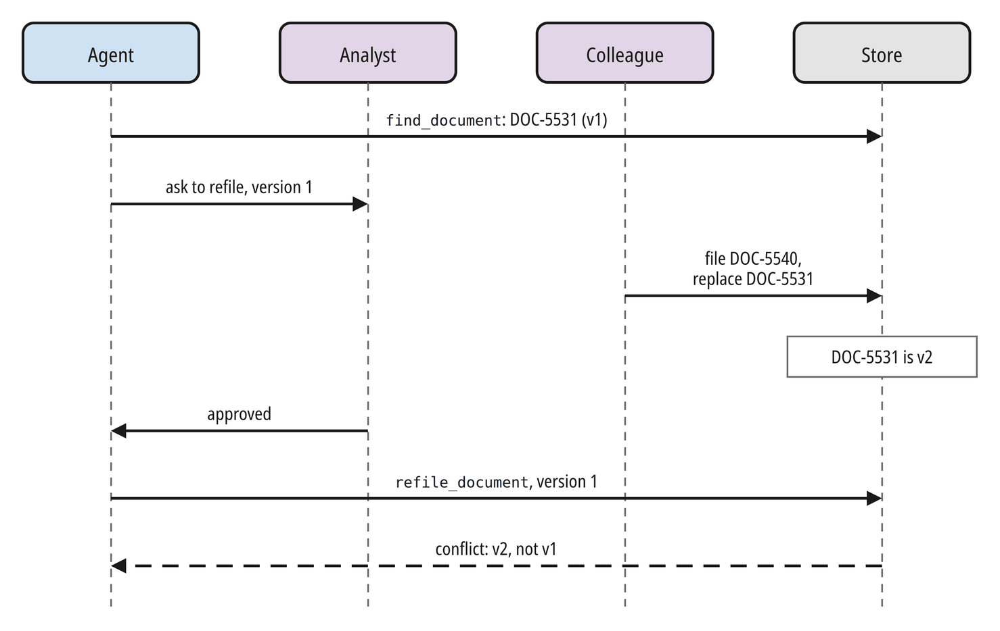
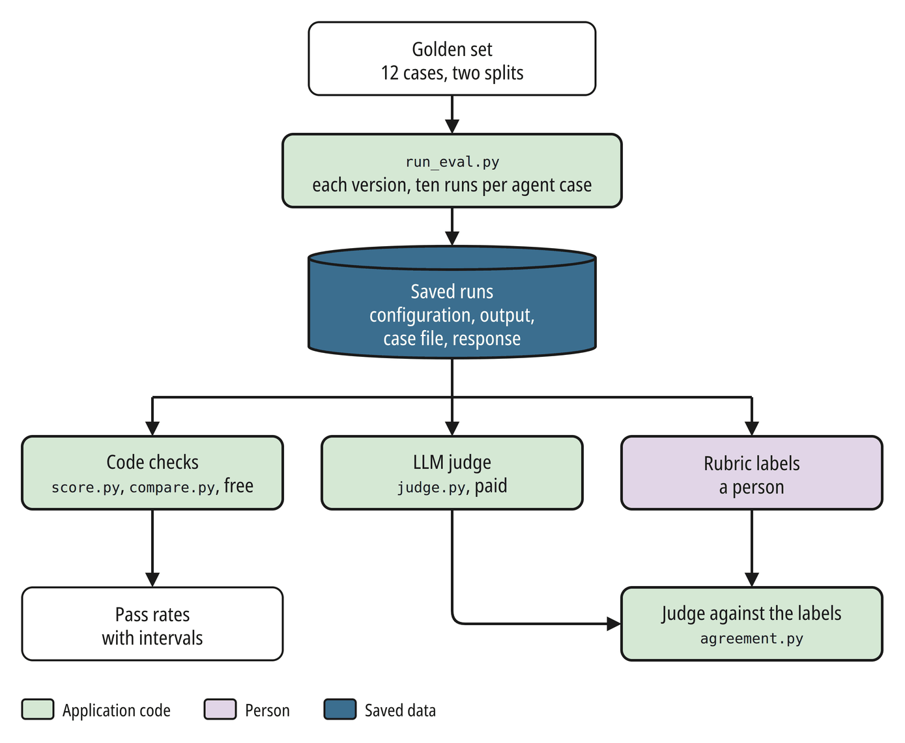

# Agentic AI Engineering



**A book series on building AI agents a business can run.**

Building an AI agent is easy. Point a model at a few tools, write a prompt, and you have a prototype running before lunch. The real engineering begins when that prototype leaves the sandbox. Before a business trusts an agent with its core processes, the system as a whole has to be reliable, observable, auditable, testable, and affordable, and that is where most architectures break down.

*Agentic AI Engineering* is about that system. It's written for engineers, architects, technical leads, and engineering managers who know how to build services and want to know what changes when part of the system is a language model choosing what to do. You need a background in software engineering, not in machine learning.

This repository is the series' home. It has the companion code for every volume, and a preview of each volume you can read now.

## The Volumes

The series comes in four volumes. Each is a book of its own, ordered by the questions a team meets as it moves agents toward production, and each builds on the application the one before it leaves behind.

| Volume | What it covers | Status |
|---|---|---|
| **1. Agent Foundations and Quality Engineering** | Building one agent from its parts, then testing, evaluating, and observing it. | Coming soon |
| **2. Multi-Agent Architecture and Knowledge Engineering** | Orchestrating several agents, persistent state, memory, and permission-aware retrieval of company knowledge. | Forthcoming |
| **3. Enterprise Integration, Reliability, Security, and Operations** | Connecting the system to real services, then making it resilient, secure, governed, and operable, ending with a capstone. | Forthcoming |
| **4. Deployment, Performance, and Scalability** | Deploying the system and making it fast and scalable. | Forthcoming |

## Volume 1: Agent Foundations and Quality Engineering

<table align="center"><tr><td align="center">
<h2>Coming Soon</h2>
<p>The Kindle eBook is coming soon to Amazon. Watch this repository for the launch.</p>
<p>While you wait, <a href="#look-inside">look inside the book</a>.</p>
</td></tr></table>

This volume lays out a practical recipe for production agent systems, one step at a time:

- **Built up from first principles.** The book teaches every topic in depth, explaining how each one works underneath before building it into working code: the agent's own mechanics, failure handling, context management, approval gates, typed outputs, workflows, testing, evaluation, and tracing.
- **Problem first, then solution.** Each chapter starts from a failure that agents run into in practice, explains why it happens, works through an implementation, and weighs the trade-offs between competing approaches.
- **Depth through visuals.** The book is richly illustrated, showing what happens at each boundary of an agent run. The traces, metrics, and model outputs shown come from real runs of the companion code.
- **Framework and cloud independent.** The book uses Microsoft Agent Framework as its teaching medium, but teaches every concept so that you can carry it over to any framework or cloud platform and apply it there.

### Contents

<table>
<tr><th>Chapter</th><th>Title</th><th>What you'll learn</th></tr>
<tr><td align="right">1</td><td><b>Introduction: The Agent and the System Around It</b></td><td>What an agent is, and what the system around it must provide.</td></tr>
<tr><td colspan="3"><b>Part I: Foundations of Agentic AI</b></td></tr>
<tr><td align="right">2</td><td><b>From Programs to Agents</b></td><td>When a problem needs an agent, and which parts ordinary code handles better.</td></tr>
<tr><td align="right">3</td><td><b>Anatomy of an Agent</b></td><td>The six parts of an agent, built by hand, and how to find the one to fix.</td></tr>
<tr><td align="right">4</td><td><b>A First Agent in Microsoft Agent Framework</b></td><td>The same agent rebuilt in the framework and traced from request to stop.</td></tr>
<tr><td align="right">5</td><td><b>Tools and Failure Recovery</b></td><td>Tools that cope with wrong requests and failing systems, with retries that don&#x27;t add to an outage.</td></tr>
<tr><td align="right">6</td><td><b>State and Context Engineering</b></td><td>Sessions, context budgets, and compaction.</td></tr>
<tr><td align="right">7</td><td><b>Context Providers</b></td><td>Providers that supply current records.</td></tr>
<tr><td align="right">8</td><td><b>Middleware and Agent Hooks</b></td><td>Middleware that writes the audit trail and can stop a run.</td></tr>
<tr><td align="right">9</td><td><b>Tool Approval and Human Gates</b></td><td>Human approval before a record changes, including approvals that go stale.</td></tr>
<tr><td align="right">10</td><td><b>Structured Output and Contracts</b></td><td>Typed contracts for the agent&#x27;s finding, with checks and repair.</td></tr>
<tr><td align="right">11</td><td><b>Basic Workflows</b></td><td>Workflows that take a fixed procedure out of the model&#x27;s hands.</td></tr>
<tr><td colspan="3"><b>Part II: Testing, Evaluating and Improving an Agent</b></td></tr>
<tr><td align="right">12</td><td><b>Testing Agentic Applications</b></td><td>Tests that replay recorded model replies, plus a few against the live model.</td></tr>
<tr><td align="right">13</td><td><b>Evaluating Agent Outcomes</b></td><td>Golden sets, scoring with code and an LLM judge, and how far you can trust ten runs.</td></tr>
<tr><td align="right">14</td><td><b>Observing Runs and Measuring Cost</b></td><td>Tracing a wrong finding back to its cause, and measuring what each run costs.</td></tr>
<tr><td align="right">15</td><td><b>Project 1: An Evaluated Exception Research Agent</b></td><td>A shipping-exception research agent, assembled from these parts and evaluated end to end.</td></tr>
</table>

## Look Inside

<div align="center">
<h2><a href="https://github.com/gitkeerthi/agentic-ai-engineering/raw/main/previews/volume-1/agentic-ai-engineering-volume-1-preview.pdf">Download the book preview (PDF)</a></h2>
</div>

**Who controls the path.** Chapter 2 sorts AI applications into six stages by how much of the path the model decides.



**The parts of an agent.** Chapter 3 builds an agent by hand from instructions, a task, tool descriptions, and history, so you can see what each part contributes to a decision.



**Three layers behind one model call.** Chapter 6 follows a single model call through the session, kept between runs; the run's message list, gone when the run ends; and the context sent to the model, after compaction has left out the oldest message groups.



**One audit trail for every tool.** Chapter 8 records every tool call in middleware instead of inside each tool. The middleware writes the record before the tool runs, and if it can't, the tool doesn't run. From `code/volume-1/ch08/middleware.py`:

```python
@function_middleware
async def audit_trail(context: FunctionInvocationContext, call_next) -> None:
    ...
    audit_store.write({**record, "phase": "requested"})
    await call_next()
    ...
    finish(record, phase="completed", result=context.result)
```

**An approval that goes stale.** In Chapter 9, a colleague replaces a document while the agent's refiling request waits for an analyst. The analyst approves the request as it was made, against version 1. The store now holds version 2, so it refuses the refiling as a conflict instead of acting on a document that has changed.



**A contract for the answer.** Chapter 10 types the agent's finding as a Pydantic model, so a finding whose parts disagree, such as a cause with no evidence, fails validation. From `code/volume-1/ch10/contracts.py`:

```python
class Finding(BaseModel):
    shipment_id: str = Field(pattern=r"^SH-\d{4}$")
    status: Literal["cause_found", "nothing_wrong", "undetermined"] = Field(...)
    cause: str | None = Field(...)
    evidence: list[Evidence] = Field(...)
    recommended_action: str | None = Field(...)
    refiling: Refiling | None = Field(...)

    @model_validator(mode="after")
    def parts_agree(self) -> "Finding":
        if self.status == "cause_found" and not (self.cause and self.evidence):
            raise ValueError(
                "cause_found needs a cause and at least one piece of evidence")
        if self.status != "cause_found" and (self.cause or self.refiling):
            raise ValueError(
                f"status {self.status} can't come with a cause or a refiling")
        return self
```

**Run once, score many times.** Chapter 13 saves every run of the agent, then scores the saved runs three ways: code checks, an LLM judge, and a person's rubric labels, which in turn check the judge.



## Run the Code

Each volume's code is a project of its own in `code/volume-N/`, with its own `pyproject.toml` and `uv.lock`, so a later volume's upgrades never change what an earlier one shows. You need [uv](https://docs.astral.sh/uv/) and an API key for a model provider. uv downloads Python 3.13 if you don't have it. Chapter 14 also runs Langfuse, an observability platform, in Docker.

```bash
git clone https://github.com/gitkeerthi/agentic-ai-engineering.git
cd agentic-ai-engineering/code/volume-1
cp .env.example .env      # then add your key to .env
uv sync
uv run python ch02/next_token.py
```

Run every command for a volume from its folder, exactly as the book's listings show it. Each chapter's folder has a README that lists its programs, says which listing each one produced, and suggests experiments. Start with [`code/volume-1/README.md`](code/volume-1/README.md).

## About the Author

**Keerthi Panneerselvam** is a principal architect with more than 25 years of experience engineering enterprise software across finance, healthcare, and insurance. An early adopter of AI, Keerthi now architects and builds multi-agent systems, bringing agentic capability into the business applications companies already run. This series draws on that work: the architecture and operating practices it takes to move agentic AI from prototype to production.

## License

The code in [`code/`](code/) is released under the [MIT License](code/LICENSE).

The books, their text, figures, and covers, and the preview PDFs and images in this repository are © 2026 Keerthi Panneerselvam, all rights reserved. You're welcome to share the preview PDFs unchanged.
